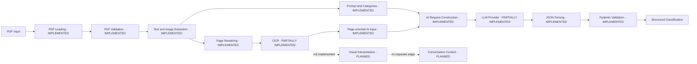
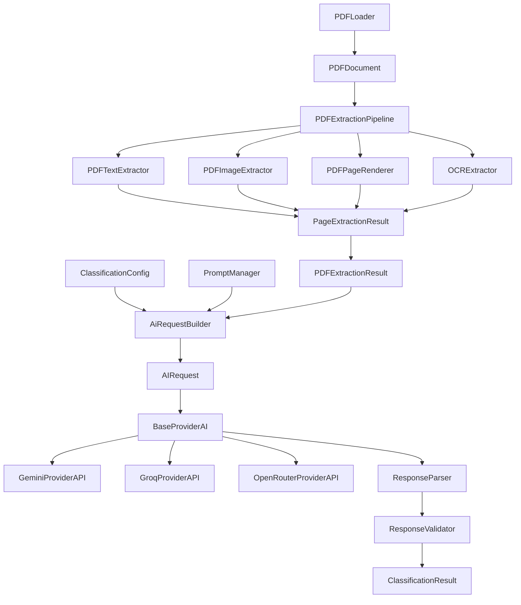

# Intelligent Document Framework

A modular Python framework for PDF extraction, OCR, multimodal AI request construction, and Pydantic-validated document classification.

Documentation:

- English
- [Português (Brasil)](README.pt-BR.md)

**Development status:** MVP / in progress

**Python:** 3.12+


> Badges reflect technologies declared or used in the repository. No package-registry or release badge is claimed.

## Table of Contents

- [Project Overview](#project-overview)
- [Key Features](#key-features)
- [Architecture](#architecture)
- [Architecture Diagrams](#architecture-diagrams)
- [Project Structure](#project-structure)
- [Technology Stack](#technology-stack)
- [Installation](#installation)
- [Configuration](#configuration)
- [Usage Examples](#usage-examples)
- [AI Architecture and Provider Abstraction](#ai-architecture-and-provider-abstraction)
- [Classification System](#classification-system)
- [Structured Output](#structured-output)
- [Testing](#testing)
- [Roadmap](#roadmap)
- [Current Limitations](#current-limitations)
- [Design Principles](#design-principles)
- [Contributing](#contributing)
- [License](#license)
- [Acknowledgments](#acknowledgments)

## Project Overview

Intelligent Document Framework processes PDF documents and combines their native text, embedded images, rendered pages, and optional Tesseract OCR text. It also provides data structures and provider adapters for sending the extracted information to a multimodal AI model and validating its classification response with Pydantic.

Plain PDF text extraction is insufficient for documents that contain screenshots, scanned pages, tables, embedded evidence, or competing sources of meaning. Traditional PDF processing can recover text and page images, but it does not by itself determine document intent or preserve a defensible page-level evidence trail.

The framework separates:

- **Traditional PDF processing:** loading, validation, text extraction, image extraction, page rendering, and OCR.
- **Intelligent document processing:** combining text and visual evidence, building a page-oriented AI input, selecting a configured category, and validating a structured result.

The implementation should not be described as a complete conversation-analysis system: conversation reconstruction, sender/timestamp extraction, message ordering, and evidence consolidation beyond individual page objects are not currently implemented.

## Key Features

### Implemented Features

| Feature | Status | Evidence |
|---|---|---|
| PDF loading and metadata | **IMPLEMENTED** | `PDFLoader` and `PDFDocument` |
| File existence, extension, and size validation | **IMPLEMENTED** | `PDFValidator` |
| Native text extraction | **IMPLEMENTED** | `PDFTextExtractor` |
| Embedded image extraction | **IMPLEMENTED** | `PDFImageExtractor` |
| Full-page PNG rendering | **IMPLEMENTED** | `PDFPageRenderer` |
| Tesseract OCR | **PARTIALLY IMPLEMENTED** | `OCRExtractor` exists; Tesseract and `TESSERACT_CMD` are required |
| Ordered page aggregation | **IMPLEMENTED** | `PDFExtractionPipeline` |
| Classification categories | **IMPLEMENTED** | `CategoryDefinition` and `ClassificationConfig` |
| Default category configuration | **IMPLEMENTED** | `DEFAULT_CLASSIFICATION` |
| Prompt loading | **IMPLEMENTED** | `PromptManager` |
| AI request construction | **IMPLEMENTED** | `AiRequestBuilder` and `AIRequest` |
| Gemini request/response integration | **PARTIALLY IMPLEMENTED** | `GeminiProviderAPI` exists; the provider dependency and source integration are available, but network behavior is not part of the test suite |
| Groq request/response integration | **PARTIALLY IMPLEMENTED** | `GroqProviderAPI` exists, but `groq` is not declared in project dependencies |
| OpenRouter request/response integration | **PARTIALLY IMPLEMENTED** | `OpenRouterProviderAPI` exists, but `openai` is not declared and `.env.example` does not list `OPEN_ROUTER_KEY` |
| JSON parsing | **IMPLEMENTED** | `ResponseParser` |
| Pydantic response validation | **IMPLEMENTED** | `ResponseValidator` and `ClassificationResult` |
| AI response pipeline | **IMPLEMENTED** | `AiPipeline` coordinates provider, parser, and validator |

### Planned Features

| Feature | Status |
|---|---|
| Conversation message/sender/timestamp reconstruction | **PLANNED** |
| Conversation ordering and context consolidation | **PLANNED** |
| Dedicated visual-evidence interpretation workflow | **PLANNED**; provider adapters can currently send images, but no separate interpretation stage exists |
| Additional provider implementations | **PLANNED** |
| Complete end-to-end integration tests | **PLANNED** |
| Packaging and release preparation | **PLANNED** |

## Architecture

### Document Ingestion

- `PDFLoader(max_size_mb=10)` creates a `PDFValidator` and delegates validation before opening the file. It accepts `Path | str`, returns `PDFDocument`, and raises `FileNotFoundError` or `ValueError`.
- `PDFValidator(max_size_mb=50)` verifies that the path is a file, that the extension is `.pdf`, and that the file does not exceed the configured byte limit. It does **not** verify PDF file structure or corruption.
- `PDFDocument` is a frozen dataclass containing `file_path`, `filename`, `file_size_bytes`, and `page_count`.

### Extraction

- `PDFTextExtractor.extract(document)` returns `list[ExtractedPage]`, with embedded text from `PyMuPDF` `get_text()`. Page numbers start at 1.
- `PDFImageExtractor.extract(document)` returns `list[ExtractedImage]`, with raw image bytes and extension for images stored as PDF objects.
- `PDFPageRenderer.render(document, dpi=150)` returns `list[RenderedPage]`, with each complete page encoded as PNG bytes.
- `OCRExtractor(languages="por+eng")` is constructed only when OCR is enabled. It reads `TESSERACT_CMD`, validates the executable path, and returns `list[ExtractedPage]` for rendered pages.
- `PDFExtractionPipeline(enable_ocr=False)` executes text extraction, embedded-image extraction, page rendering, and optional OCR. `run_pipeline(document)` returns `PDFExtractionResult`.

The extraction models are dataclasses:

- `ExtractedPage(page_number, content_page)`
- `ExtractedImage(page_number, image_index, image_bytes, extension)`
- `RenderedPage(page_number, image_bytes, extension)`
- `PageExtractionResult(page_number, native_text, ocr_text, images, rendered_page=None)`
- `PDFExtractionResult(document, pages)`

### Classification Configuration

- `CategoryDefinition` is a dataclass with `name`, `description`, `criteria`, `exclusion_criteria`, and `examples`.
- `ClassificationConfig` is a Pydantic model requiring at least one category and rejecting duplicate normalized category names.
- `DEFAULT_CLASSIFICATION` defines `Solicitação`, `Dúvida`, `Reclamação`, `Contestação`, `Informativo`, and `Outros`. Its default `criteria`, `exclusion_criteria`, and `examples` lists are empty.

### Prompt and AI Requests

- `PromptManager(templates_dir=None)` loads an existing UTF-8 template, rejects paths outside `templates_dir`, empty templates, and missing files.
- `AiRequestBuilder(templates_dir)` loads `document_classification.md` and combines it with a `ClassificationConfig` and `PDFExtractionResult` in `AIRequest`.
- `AIRequest` contains `content_extraction`, `classification_config`, and `system_prompt`.

### Provider and Response Layers

- `BaseProviderAI` is an abstract provider contract with `generate_response(request_content: AIRequest) -> str`.
- `GeminiProviderAPI`, `GroqProviderAPI`, and `OpenRouterProviderAPI` implement provider-specific request construction.
- `GeminiProviderAPI` sends text and base64 images through `google.genai`; it supports PNG, JPEG, and WebP images.
- `GroqProviderAPI` sends text and data-URL images through the Groq SDK and limits a document to at most three image items.
- `OpenRouterProviderAPI` uses the OpenAI SDK against `https://openrouter.ai/api/v1`.
- `ResponseParser.parse(raw_response)` requires a string and converts it to JSON or raises `ValueError`.
- `ResponseValidator.validate(response)` applies strict Pydantic validation to `ClassificationResult`.
- `AiPipeline.run_pipelineAI(...)` is the final orchestration method: provider generation, JSON parsing, and Pydantic validation.

Dependency direction is extraction -> core models -> AI request -> provider abstraction; provider-specific communication remains behind `BaseProviderAI`, while response parsing and Pydantic validation are separate stages.

## Architecture Diagrams

### High-Level Processing Workflow



### Component Architecture



## Project Structure

```text
intelligent-document-classification-framework/
├── pyproject.toml
├── requirements.txt
├── requirements-dev.txt
├── .env.example
├── mock_docs/
├── src/
│   ├── main.py
│   ├── docframework/
│   │   ├── core/
│   │   ├── ingestion/
│   │   ├── extraction/
│   │   └── intelligence/
│   │       ├── configuration/
│   │       ├── prompts/
│   │       ├── providers/
│   │       ├── requests/
│   │       └── response/
│   └── outputs/
└── tests/
    └── unit/
```

`src/docframework/ingestion/` loads and validates PDFs; `extraction/` recovers text, images, rendered pages, and OCR; `core/` contains shared dataclasses and Pydantic models; `intelligence/` contains configuration, prompts, providers, request construction, and response handling. `src/main.py` demonstrates one local end-to-end script. `mock_docs/` contains sample PDFs.

## Technology Stack

### Declared Python dependencies

| Dependency | Purpose |
|---|---|
| PyMuPDF (`pymupdf`) | Open PDFs, extract text/images, and render pages |
| Pillow | Open rendered images for Tesseract |
| Pydantic | Strict structured response and configuration models |
| pydantic-settings | Declared dependency; no direct source usage was confirmed |
| PyYAML | Declared dependency; no direct source usage was confirmed |
| python-dotenv | Load `.env` variables |
| pytesseract | Python wrapper for Tesseract OCR |
| google-genai | Gemini provider SDK |
| pytest | Development test runner |

### External system dependencies

- **Tesseract OCR** is required only when `OCRExtractor` or `PDFExtractionPipeline(enable_ocr=True)` is used.
- Tesseract language data for `por+eng` must be installed for the current default OCR languages.

### Undeclared provider dependencies

The source imports `groq` in `GroqProviderAPI` and `openai` in `OpenRouterProviderAPI`, but neither package is declared in `pyproject.toml` or `requirements.txt`. A clean installation may therefore fail to import or use these providers.

## Installation

The project requires Python 3.12 or newer.

```powershell
cd intelligent-document-classification-framework
python -m venv .venv
.\.venv\Scripts\Activate.ps1
python -m pip install --upgrade pip
python -m pip install -e ".[dev]"
```

Linux or macOS:

```bash
cd intelligent-document-classification-framework
python3 -m venv .venv
source .venv/bin/activate
python -m pip install --upgrade pip
python -m pip install -e ".[dev]"
```

The editable package includes runtime dependencies and the `dev` extra. Install Tesseract separately if OCR is needed. The project is not confirmed to be published on PyPI.

## Configuration

The repository uses `python-dotenv` and environment variables.

| Variable | Used by | Status |
|---|---|---|
| `TESSERACT_CMD` | `OCRExtractor` | Required for OCR |
| `GEMINI_API_KEY` | Gemini provider/main script | Optional for Gemini usage |
| `GROQ_API_KEY` | `.env.example`; no provider constructor currently reads it directly | Provider-specific setup |
| `OPEN_ROUTER_KEY` | `src/main.py` | OpenRouter usage; missing from `.env.example` |

Example `.env`:

```dotenv
GEMINI_API_KEY=replace-me
GROQ_API_KEY=replace-me
OPEN_ROUTER_KEY=replace-me
TESSERACT_CMD=C:/Program Files/Tesseract-OCR/tesseract.exe
```

Do not commit real credentials. Provider clients receive API keys through constructor arguments; `GEMINI_API_KEY` is also loaded at module scope in the Gemini provider but that module-level value is not passed to the constructor automatically.

Tesseract OCR loads `.env` with `override=True` in `OCRExtractor`. Classification categories are currently Python objects or Pydantic models; no external YAML/JSON classification file loader is implemented.

## Usage Examples

### PDF Loading

```python
from pathlib import Path
from docframework.ingestion.pdf_loader import PDFLoader

document = PDFLoader(max_size_mb=60).load(Path("document.pdf"))
print(document.filename, document.page_count)
```

### PDF Validation

```python
from docframework.ingestion.pdf_validator import PDFValidator

try:
    PDFValidator(max_size_mb=60).validate("document.pdf")
except (FileNotFoundError, ValueError) as exc:
    print(exc)
```

### PDF Extraction

```python
from pathlib import Path
from docframework.ingestion.pdf_loader import PDFLoader
from docframework.extraction.pdf_extraction_pipeline import PDFExtractionPipeline

document = PDFLoader(max_size_mb=60).load(Path("document.pdf"))
result = PDFExtractionPipeline(enable_ocr=False).run_pipeline(document)
```

OCR requires Tesseract and `TESSERACT_CMD`:

```python
result = PDFExtractionPipeline(enable_ocr=True).run_pipeline(document)
```

### Accessing Extraction Results

```python
for page in result.pages:
    print("Page:", page.page_number)

    if page.native_text:
        print("Native text:", page.native_text.content_page)

    if page.ocr_text:
        print("OCR text:", page.ocr_text.content_page)

    for image in page.images:
        print("Embedded image:", image.image_index, image.extension, len(image.image_bytes))

    if page.rendered_page:
        print("Rendered page:", page.rendered_page.extension, len(page.rendered_page.image_bytes))
```

### AI Request Construction

```python
from pathlib import Path
from docframework.intelligence.configuration.default_categories import DEFAULT_CLASSIFICATION
from docframework.intelligence.requests.ai_request_builder import AiRequestBuilder

templates_dir = Path("src/docframework/intelligence/prompts/templates")
request = AiRequestBuilder(templates_dir=templates_dir).build(
    template_name="document_classification.md",
    config_classification=DEFAULT_CLASSIFICATION,
    results_extraction_document=result,
)
```

`AiRequestBuilder.build()` requires all three arguments shown above and returns `AIRequest`.

### Provider Execution

```python
import os
from docframework.intelligence.providers.gemini_provider_api import GeminiProviderAPI
from docframework.intelligence.response.response_parser import ResponseParser
from docframework.intelligence.response.response_validator import ResponseValidator
from docframework.intelligence.ai_pipeline import AiPipeline

provider = GeminiProviderAPI(
    api_key=os.environ["GEMINI_API_KEY"],
    model="gemini-2.5-flash",
)

classification = AiPipeline().run_pipelineAI(
    request=request,
    provider=provider,
    response_parser=ResponseParser(),
    response_validator=ResponseValidator(),
)
```

Network calls require valid credentials and an available model. This README does not claim that a live provider call was executed.

### Structured Classification

```python
print(classification.document_type)
print(classification.classification)
print(classification.summary)
print(classification.classification_reason)

for evidence in classification.evidence:
    print(evidence.page_number, evidence.description)
```

## AI Architecture and Provider Abstraction

Prompt management, extraction models, classification configuration, provider communication, response parsing, and Pydantic validation are represented by separate classes. `BaseProviderAI` exposes `generate_response(request_content: AIRequest) -> str`, allowing providers to implement the same `AiPipeline` contract.

Gemini currently sends native text, OCR text, embedded images, and rendered pages in a provider-specific list. Groq and OpenRouter build OpenAI-compatible message content and send text plus data-URL images. Groq additionally enforces a maximum of three image items.

The abstraction is architectural, not a claim of verified interoperability. Live provider behavior is not covered by the executed test suite, and Groq/OpenRouter dependencies are missing from the package manifests.

## Classification System

`CategoryDefinition` has these fields:

- `name: str`
- `description: str`
- `criteria: list[str]`
- `exclusion_criteria: list[str]`
- `examples: list[str]`

`ClassificationConfig` requires at least one category and rejects duplicate category names after whitespace removal and case normalization.

```python
from docframework.intelligence.configuration.category_definition import CategoryDefinition
from docframework.intelligence.configuration.classification_config import ClassificationConfig

config = ClassificationConfig(categories=[
    CategoryDefinition(
        name="Solicitação",
        description="The sender requests an action or change.",
        criteria=["An explicit action is requested."],
        exclusion_criteria=["The message only reports information."],
        examples=["Please change the due date."],
    )
])
```

The default category names are Portuguese, as supplied by `default_categories.py`.

## Structured Output

`ClassificationResult` is a strict Pydantic model:

| Field | Type | Constraints |
|---|---|---|
| `document_type` | `str` | Minimum length 1 after whitespace stripping |
| `classification` | `str` | Minimum length 1 after whitespace stripping |
| `summary` | `str` | Minimum length 1 after whitespace stripping |
| `classification_reason` | `str` | Minimum length 1 after whitespace stripping |
| `evidence` | `list[ClassificationEvidence]` | Minimum 1 item |

`ClassificationEvidence` has `page_number: int` with a minimum of 1 and `description: str` with a minimum length of 1. Both models forbid extra fields and reject non-strict values.

Example shape:

```json
{
  "document_type": "E-mail corporativo",
  "classification": "Solicitação",
  "summary": "Resumo objetivo do documento.",
  "classification_reason": "Uma ação específica é solicitada.",
  "evidence": [
    {
      "page_number": 1,
      "description": "Texto que sustenta a classificação."
    }
  ]
}
```

## Testing

The test suite uses Pytest and is configured in `pyproject.toml` with `pythonpath = ["src"]` and `testpaths = ["tests"]`.

```bash
python -m pytest -v
```

Tests currently cover PDF loading/validation, Pydantic response validation, native text extraction, and Gemini provider behavior. There are no integration or end-to-end test directories in the repository.

An execution was attempted on 2026-11-22. It stopped during collection because `test_gemini_provider_api.py` imports `docframework.core.category_definition.CategoryDefinition`, but `CategoryDefinition` is located at `docframework.intelligence.configuration.category_definition`. Result: **25 tests collected, 1 collection error; remaining tests did not execute**.

## Roadmap

| Phase | Actual status | Evidence |
|---|---|---|
| 1 - Project Foundation and PDFLoader | **Completed** | Project structure, PDF loading, and basic validation exist |
| 2 - Text and Image Extraction | **Completed** | Text, images, rendering, and extraction aggregation exist |
| 3 - OCR and Visual Understanding | **In Progress** | OCR and provider image input exist; screenshot interpretation and an independent visual stage remain incomplete |
| 4 - Conversation Context Construction | **Planned** | No sender, timestamp, message, or conversation-context implementation was found |
| 5 - LLM Classification and Structured Output | **In Progress** | Categories, prompts, AI requests, provider adapters, parsing, and Pydantic validation exist; provider interoperability and end-to-end reliability are not verified |
| 6 - Testing, Documentation and Release | **In Progress** | Unit tests and documentation exist, but suite collection currently fails and packaging/release is not complete |

## Current Limitations

- The PDF validator checks extension and size only; it does not validate PDF structure before extraction.
- OCR is external to the package and requires Tesseract plus matching language data.
- Native text extraction does not recover text from scanned pages.
- `PDFImageExtractor` extracts stored image objects; it does not represent arbitrary text or vector drawing as evidence.
- No conversation-context model or sender/timestamp/message reconstruction implementation was found.
- Provider integrations are source implementations, not end-to- end verified integrations.
- `groq` and `openai` are imported but missing from dependency declarations.
- `.env.example` does not declare `OPEN_ROUTER_KEY`, although `src/main.py` reads it.
- The test suite does not currently collect successfully because of an incorrect test import.
- The test suite contains provider code that appears inconsistent with the current Gemini implementation, and its live behavior was not verified.
- No license file was found.
- No existing README was found before this documentation was created.

## Design Principles

- **Separation of concerns:** PDF ingestion, extraction, AI request construction, provider communication, parsing, and validation are separate modules.
- **Modularity:** each extractor and provider is represented independently.
- **Typed models:** dataclasses preserve extraction structures and Pydantic models enforce response/configuration constraints.
- **Evidence-oriented output:** classification evidence includes page numbers and descriptions.
- **Provider extensibility:** providers implement `BaseProviderAI`, although no provider guarantees provider-level interoperability.
- **Testability:** `AiPipeline` accepts parser, validator, and provider objects and Gemini provider behavior is partially isolated with mocks.

## Contributing

1. Fork or branch the repository and create a feature branch.
2. Keep changes within the existing `src/docframework/` package structure.
3. Add focused tests under `tests/unit/` for new behavior.
4. Run `python -m pytest -v`.
5. Do not commit credentials or `.env` files.
6. Open a pull request describing source changes and validation performed.

No separate contribution policy was found in the repository.

## License

No `LICENSE`, `COPYING`, or equivalent license file was found. The project license is **not yet defined**.

## Acknowledgments

The implementation uses PyMuPDF, Pillow, Pytesseract, Pydantic, python-dotenv, Google Gen AI SDK, Groq SDK, and OpenAI SDK for OpenRouter-compatible requests. Tesseract OCR is an external system dependency.
