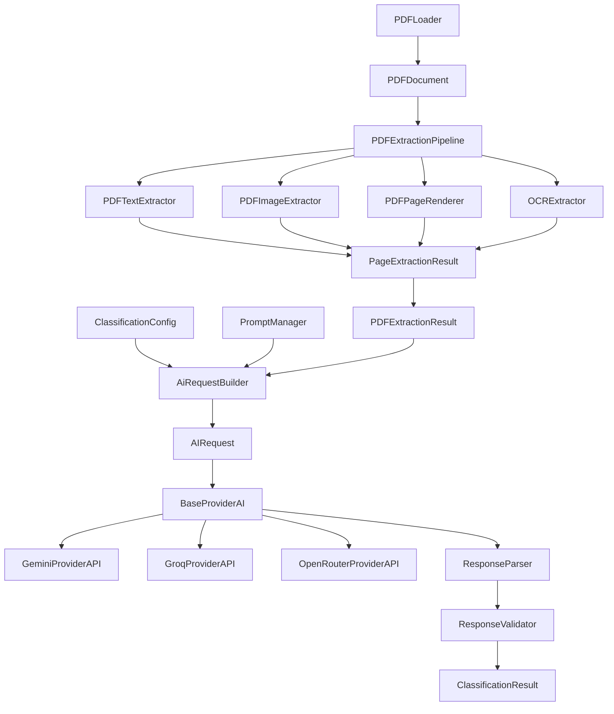

# Intelligent Document Framework

Uma biblioteca Python modular para extração de PDFs, OCR, construção de requisições de IA multimodal e classificação de documentos validada com Pydantic.

Documentação:

- [English](README.md)
- Português (Brasil)

**Status de desenvolvimento:** MVP / em andamento

**Python:** 3.12+


> Os badges refletem tecnologias declaradas ou utilizadas no repositório. Nenhum badge de registro de pacotes ou de release é reivindicado.

## Sumário

- [Visão Geral do Projeto](#visão-geral-do-projeto)
- [Principais Recursos](#principais-recursos)
- [Arquitetura](#arquitetura)
- [Diagramas de Arquitetura](#diagramas-de-arquitetura)
- [Estrutura do Projeto](#estrutura-do-projeto)
- [Stack Tecnológica](#stack-tecnológica)
- [Instalação](#instalação)
- [Configuração](#configuração)
- [Exemplos de Uso](#exemplos-de-uso)
- [Arquitetura de IA e Abstração de Provedores](#arquitetura-de-ia-e-abstração-de-provedores)
- [Sistema de Classificação](#sistema-de-classificação)
- [Saída Estruturada](#saída-estruturada)
- [Testes](#testes)
- [Roadmap](#roadmap)
- [Limitações Atuais](#limitações-atuais)
- [Princípios de Design](#princípios-de-design)
- [Como Contribuir](#como-contribuir)
- [Licença](#licença)
- [Agradecimentos](#agradecimentos)

## Visão Geral do Projeto

O Intelligent Document Framework processa documentos PDF e combina seu texto nativo, imagens incorporadas, páginas renderizadas e texto OCR opcional do Tesseract. Também fornece estruturas de dados e adaptadores de provedores para enviar as informações extraídas a um modelo de IA multimodal e validar sua resposta de classificação com Pydantic.

A simples extração de texto de PDF não é suficiente para documentos que contenham capturas de tela, páginas digitalizadas, tabelas, evidências incorporadas ou fontes de significado conflitantes. O processamento tradicional pode recuperar texto e imagens de páginas, mas não determina por si só a intenção do documento nem preserva uma trilha de evidências por página.

O framework separa:

- **Processamento tradicional de PDF:** carregamento, validação, extração de texto, extração de imagens, renderização de páginas e OCR.
- **Processamento inteligente de documentos:** combinação de texto e evidências visuais, construção de entrada de IA orientada por páginas, seleção de uma categoria configurada e validação de resultado estruturado.

O projeto não deve ser descrito como um sistema completo de análise de conversas: reconstrução de conversas, extração de remetente/data-hora, ordenação de mensagens e consolidação de evidências além dos objetos individuais por página não estão implementadas.

## Principais Recursos

### Recursos Implementados

| Recurso | Status | Evidência |
|---|---|---|
| Carregamento e metadados do PDF | **IMPLEMENTADO** | `PDFLoader` e `PDFDocument` |
| Validação de existência, extensão e tamanho | **IMPLEMENTADO** | `PDFValidator` |
| Extração de texto nativo | **IMPLEMENTADO** | `PDFTextExtractor` |
| Extração de imagens incorporadas | **IMPLEMENTADO** | `PDFImageExtractor` |
| Renderização completa de páginas como PNG | **IMPLEMENTADO** | `PDFPageRenderer` |
| OCR com Tesseract | **PARCIALMENTE IMPLEMENTADO** | `OCRExtractor` existe; Tesseract e `TESSERACT_CMD` são necessários |
| Agregação ordenada por página | **IMPLEMENTADO** | `PDFExtractionPipeline` |
| Categorias de classificação | **IMPLEMENTADO** | `CategoryDefinition` e `ClassificationConfig` |
| Configuração padrão de categorias | **IMPLEMENTADO** | `DEFAULT_CLASSIFICATION` |
| Gerenciamento de prompts | **IMPLEMENTADO** | `PromptManager` |
| Construção de requisições de IA | **IMPLEMENTADO** | `AiRequestBuilder` e `AIRequest` |
| Integração Gemini | **PARCIALMENTE IMPLEMENTADO** | `GeminiProviderAPI` existe; a dependência e a integração de fonte estão disponíveis, mas o comportamento em rede não faz parte da suíte de testes |
| Integração Groq | **PARCIALMENTE IMPLEMENTADO** | `GroqProviderAPI` existe, mas `groq` não está declarado nas dependências do projeto |
| Integração OpenRouter | **PARCIALMENTE IMPLEMENTADO** | `OpenRouterProviderAPI` existe, mas `openai` não está declarado e `.env.example` não lista `OPEN_ROUTER_KEY` |
| Parsing de JSON | **IMPLEMENTADO** | `ResponseParser` |
| Validação Pydantic da resposta | **IMPLEMENTADO** | `ResponseValidator` e `ClassificationResult` |
| Pipeline de resposta de IA | **IMPLEMENTADO** | `AiPipeline` coordena provider, parser e validator |

### Recursos Planejados

| Recurso | Status |
|---|---|
| Reconstrução de mensagens, remetentes e data/hora | **PLANEJADO** |
| Ordenação de conversas e consolidação de contexto | **PLANEJADO** |
| Fluxo dedicado de interpretação de evidências visuais | **PLANEJADO**; os adaptadores já podem enviar imagens, mas não existe estágio independente de interpretação |
| Implementações adicionais de provedores | **PLANEJADO** |
| Testes completos de integração ponta a ponta | **PLANEJADO** |
| Empacotamento e preparação de release | **PLANEJADO** |

## Arquitetura

### Ingestão de Documentos

- `PDFLoader(max_size_mb=10)` cria um `PDFValidator` e delega a validação antes de abrir o arquivo. Aceita `Path | str`, retorna `PDFDocument` e lança `FileNotFoundError` ou `ValueError`.
- `PDFValidator(max_size_mb=50)` verifica se o caminho é um arquivo, se a extensão é `.pdf` e se o tamanho não excede o limite configurado em bytes. Ele **não** verifica a estrutura do PDF nem corrupção.
- `PDFDocument` é um dataclass congelado com `file_path`, `filename`, `file_size_bytes` e `page_count`.

### Extração

- `PDFTextExtractor.extract(document)` retorna `list[ExtractedPage]`, com texto incorporado obtido pelo `get_text()` do `PyMuPDF`. A página inicial é 1.
- `PDFImageExtractor.extract(document)` retorna `list[ExtractedImage]`, com bytes brutos e extensão das imagens armazenadas como objetos do PDF.
- `PDFPageRenderer.render(document, dpi=150)` retorna `list[RenderedPage]`, com cada página completa codificada como bytes PNG.
- `OCRExtractor(languages="por+eng")` é criado somente quando o OCR está ativado. Lê `TESSERACT_CMD`, valida o caminho do executável e retorna `list[ExtractedPage]` para as páginas renderizadas.
- `PDFExtractionPipeline(enable_ocr=False)` executa extração de texto, extração de imagens incorporadas, renderização e OCR opcional. `run_pipeline(document)` retorna `PDFExtractionResult`.

Os modelos de extração são dataclasses:

- `ExtractedPage(page_number, content_page)`
- `ExtractedImage(page_number, image_index, image_bytes, extension)`
- `RenderedPage(page_number, image_bytes, extension)`
- `PageExtractionResult(page_number, native_text, ocr_text, images, rendered_page=None)`
- `PDFExtractionResult(document, pages)`

### Configuração de Classificação

- `CategoryDefinition` é um dataclass com `name`, `description`, `criteria`, `exclusion_criteria` e `examples`.
- `ClassificationConfig` é um modelo Pydantic que exige pelo menos uma categoria e rejeita nomes normalizados duplicados.
- `DEFAULT_CLASSIFICATION` define `Solicitação`, `Dúvida`, `Reclamação`, `Contestação`, `Informativo` e `Outros`. As listas padrão de `criteria`, `exclusion_criteria` e `examples` estão vazias.

### Prompts e Requisições de IA

- `PromptManager(templates_dir=None)` carrega um template UTF-8 existente e rejeita caminhos fora de `templates_dir`, templates vazios e arquivos ausentes.
- `AiRequestBuilder(templates_dir)` carrega `document_classification.md` e combina-o com `ClassificationConfig` e `PDFExtractionResult` em `AIRequest`.
- `AIRequest` contém `content_extraction`, `classification_config` e `system_prompt`.

### Camadas de Provedores e Respostas

- `BaseProviderAI` é o contrato abstrato com `generate_response(request_content: AIRequest) -> str`.
- `GeminiProviderAPI`, `GroqProviderAPI` e `OpenRouterProviderAPI` implementam construção específica de requisições.
- `GeminiProviderAPI` envia texto e imagens em base64 por `google.genai`; suporta PNG, JPEG e WebP.
- `GroqProviderAPI` envia texto e imagens em data URL pelo SDK Groq e limita o documento a no máximo três imagens.
- `OpenRouterProviderAPI` usa o SDK OpenAI contra `https://openrouter.ai/api/v1`.
- `ResponseParser.parse(raw_response)` exige uma string e converte o conteúdo em JSON ou lança `ValueError`.
- `ResponseValidator.validate(response)` aplica validação Pydantic estrita a `ClassificationResult`.
- `AiPipeline.run_pipelineAI(...)` é o método final de orquestração: geração pelo provider, parsing de JSON e validação Pydantic.

A direção das dependências é extração -> modelos core -> requisição de IA -> abstração de provedores; a comunicação específica de provedores permanece atrás de `BaseProviderAI`, enquanto parsing e validação são etapas separadas.

## Diagramas de Arquitetura

### Fluxo de Processamento de Alto Nível

```mermaid
flowchart LR
    PDF[Entrada PDF] --> Load[Carregamento PDF - IMPLEMENTADO]
    Load --> Validate[Validação PDF - IMPLEMENTADO]
    Validate --> Extract[Extração de Texto e Imagens - IMPLEMENTADO]
    Extract --> Render[Renderização de Páginas - IMPLEMENTADO]
    Render --> OCR[OCR - PARCIALMENTE IMPLEMENTADO]
    Extract --> Prompt[Prompt e Categorias - IMPLEMENTADO]
    OCR --> AIInput[Entrada de IA por Página - IMPLEMENTADO]
    Prompt --> Request[Construção da AI Request - IMPLEMENTADO]
    AIInput --> Request
    Request --> Provider[Provedor LLM - PARCIALMENTE IMPLEMENTADO]
    Provider --> Parse[Parsing JSON - IMPLEMENTADO]
    Parse --> ValidateResult[Validação Pydantic - IMPLEMENTADO]
    ValidateResult --> Result[Classificação Estruturada]
    OCR -. não implementado .-> Visual[Interpretação Visual - PLANEJADO]
    Visual -. sem estágio separado .-> Context[Contexto da Conversa - PLANEJADO]
```



### Arquitetura de Componentes



## Estrutura do Projeto

```text
intelligent-document-classification-framework/
├── pyproject.toml
├── requirements.txt
├── requirements-dev.txt
├── .env.example
├── mock_docs/
├── src/
│   ├── main.py
│   ├── docframework/
│   │   ├── core/
│   │   ├── ingestion/
│   │   ├── extraction/
│   │   └── intelligence/
│   │       ├── configuration/
│   │       ├── prompts/
│   │       ├── providers/
│   │       ├── requests/
│   │       └── response/
│   └── outputs/
└── tests/
    └── unit/
```

`src/docframework/ingestion/` carrega e valida PDFs; `extraction/` recupera texto, imagens, páginas renderizadas e OCR; `core/` contém dataclasses compartilhados e modelos Pydantic; `intelligence/` contém configuração, prompts, provedores, construção de requisições e tratamento de respostas. `src/main.py` demonstra um script local ponta a ponta. `mock_docs/` contém PDFs de exemplo.

## Stack Tecnológica

### Dependências Python declaradas

| Dependência | Finalidade |
|---|---|
| PyMuPDF (`pymupdf`) | Abrir PDFs, extrair texto/imagens e renderizar páginas |
| Pillow | Abrir imagens renderizadas para o Tesseract |
| Pydantic | Modelos estritos de configuração e resposta |
| pydantic-settings | Dependência declarada; não foi confirmado uso direto no código-fonte |
| PyYAML | Dependência declarada; não foi confirmado uso direto no código-fonte |
| python-dotenv | Carregar variáveis de `.env` |
| pytesseract | Wrapper Python para OCR Tesseract |
| google-genai | SDK do provider Gemini |
| pytest | Executor de testes de desenvolvimento |

### Dependências externas do sistema

- **Tesseract OCR** é necessário somente quando `OCRExtractor` ou `PDFExtractionPipeline(enable_ocr=True)` é usado.
- Os dados de idioma do Tesseract para `por+eng` devem estar instalados, pois esse é o padrão atual.

### Dependências de provedores não declaradas

O código importa `groq` em `GroqProviderAPI` e `openai` em `OpenRouterProviderAPI`, mas nenhum desses pacotes está declarado em `pyproject.toml` ou `requirements.txt`. Uma instalação limpa pode falhar ao importar ou usar esses provedores.

## Instalação

O projeto requer Python 3.12 ou superior.

```powershell
cd intelligent-document-classification-framework
python -m venv .venv
.\.venv\Scripts\Activate.ps1
python -m pip install --upgrade pip
python -m pip install -e ".[dev]"
```

Linux ou macOS:

```bash
cd intelligent-document-classification-framework
python3 -m venv .venv
source .venv/bin/activate
python -m pip install --upgrade pip
python -m pip install -e ".[dev]"
```

A instalação editável inclui as dependências de runtime e o extra `dev`. Instale o Tesseract separadamente se o OCR for necessário. Não está confirmado que o projeto seja publicado no PyPI.

## Configuração

O repositório usa `python-dotenv` e variáveis de ambiente.

| Variável | Utilizada por | Status |
|---|---|---|
| `TESSERACT_CMD` | `OCRExtractor` | Necessária para OCR |
| `GEMINI_API_KEY` | Provider Gemini/main script | Opcional para uso do Gemini |
| `GROQ_API_KEY` | `.env.example`; nenhum construtor de provider a lê diretamente | Configuração específica do provider |
| `OPEN_ROUTER_KEY` | `src/main.py` | Uso do OpenRouter; ausente em `.env.example` |

Exemplo de `.env`:

```dotenv
GEMINI_API_KEY=replace-me
GROQ_API_KEY=replace-me
OPEN_ROUTER_KEY=replace-me
TESSERACT_CMD=C:/Program Files/Tesseract-OCR/tesseract.exe
```

Não faça commit de credenciais reais. Os clients recebem API keys por argumentos dos construtores; `GEMINI_API_KEY` também é carregada no âmbito do módulo no provider Gemini, mas esse valor não é enviado automaticamente ao construtor.

O OCR carrega `.env` com `override=True` em `OCRExtractor`. As categorias são objetos Python ou modelos Pydantic; não existe carregador externo de arquivos YAML/JSON de classificação.

## Exemplos de Uso

### Carregamento de PDF

```python
from pathlib import Path
from docframework.ingestion.pdf_loader import PDFLoader

document = PDFLoader(max_size_mb=60).load(Path("document.pdf"))
print(document.filename, document.page_count)
```

### Validação de PDF

```python
from docframework.ingestion.pdf_validator import PDFValidator

try:
    PDFValidator(max_size_mb=60).validate("document.pdf")
except (FileNotFoundError, ValueError) as exc:
    print(exc)
```

### Extração de PDF

```python
from pathlib import Path
from docframework.ingestion.pdf_loader import PDFLoader
from docframework.extraction.pdf_extraction_pipeline import PDFExtractionPipeline

document = PDFLoader(max_size_mb=60).load(Path("document.pdf"))
result = PDFExtractionPipeline(enable_ocr=False).run_pipeline(document)
```

O OCR requer Tesseract e `TESSERACT_CMD`:

```python
result = PDFExtractionPipeline(enable_ocr=True).run_pipeline(document)
```

### Acessando os Resultados da Extração

```python
for page in result.pages:
    print("Página:", page.page_number)

    if page.native_text:
        print("Texto nativo:", page.native_text.content_page)

    if page.ocr_text:
        print("Texto OCR:", page.ocr_text.content_page)

    for image in page.images:
        print("Imagem incorporada:", image.image_index, image.extension, len(image.image_bytes))

    if page.rendered_page:
        print("Página renderizada:", page.rendered_page.extension, len(page.rendered_page.image_bytes))
```

### Construção de AI Request

```python
from pathlib import Path
from docframework.intelligence.configuration.default_categories import DEFAULT_CLASSIFICATION
from docframework.intelligence.requests.ai_request_builder import AiRequestBuilder

templates_dir = Path("src/docframework/intelligence/prompts/templates")
request = AiRequestBuilder(templates_dir=templates_dir).build(
    template_name="document_classification.md",
    config_classification=DEFAULT_CLASSIFICATION,
    results_extraction_document=result,
)
```

`AiRequestBuilder.build()` exige os três argumentos mostrados e retorna `AIRequest`.

### Execução por Provider

```python
import os
from docframework.intelligence.providers.gemini_provider_api import GeminiProviderAPI
from docframework.intelligence.response.response_parser import ResponseParser
from docframework.intelligence.response.response_validator import ResponseValidator
from docframework.intelligence.ai_pipeline import AiPipeline

provider = GeminiProviderAPI(
    api_key=os.environ["GEMINI_API_KEY"],
    model="gemini-2.5-flash",
)

classification = AiPipeline().run_pipelineAI(
    request=request,
    provider=provider,
    response_parser=ResponseParser(),
    response_validator=ResponseValidator(),
)
```

Chamadas de rede exigem credenciais válidas e um modelo disponível. Este README não afirma que uma chamada real foi executada.

### Classificação Estruturada

```python
print(classification.document_type)
print(classification.classification)
print(classification.summary)
print(classification.classification_reason)

for evidence in classification.evidence:
    print(evidence.page_number, evidence.description)
```

## Arquitetura de IA e Abstração de Provedores

Gerenciamento de prompts, modelos de extração, configuração de categorias, comunicação com provedores, parsing de respostas e validação Pydantic são representados por classes separadas. `BaseProviderAI` expõe `generate_response(request_content: AIRequest) -> str`, permitindo que provedores implementem o mesmo contrato de `AiPipeline`.

O Gemini atualmente envia texto nativo, texto OCR, imagens incorporadas e páginas renderizadas em uma lista própria. Groq e OpenRouter construem conteúdo de mensagens compatível com OpenAI e enviam texto mais imagens em data URL. O Groq ainda impõe máximo de três imagens.

A abstração é arquitetural, não uma afirmação de interoperabilidade verificada. O comportamento ao vivo dos provedores não é coberto pela suíte executada, e as dependências Groq/OpenRouter não estão nos manifests do pacote.

## Sistema de Classificação

`CategoryDefinition` possui estes campos:

- `name: str`
- `description: str`
- `criteria: list[str]`
- `exclusion_criteria: list[str]`
- `examples: list[str]`

`ClassificationConfig` exige pelo menos uma categoria e rejeita nomes duplicados depois da remoção de espaços e normalização para minúsculas.

```python
from docframework.intelligence.configuration.category_definition import CategoryDefinition
from docframework.intelligence.configuration.classification_config import ClassificationConfig

config = ClassificationConfig(categories=[
    CategoryDefinition(
        name="Solicitação",
        description="O remetente solicita uma ação ou alteração.",
        criteria=["Uma ação explícita é solicitada."],
        exclusion_criteria=["A mensagem apenas relata informações."],
        examples=["Altere a data de vencimento."],
    )
])
```

Os nomes das categorias padrão estão em português, conforme `default_categories.py`.

## Saída Estruturada

`ClassificationResult` é um modelo Pydantic estrito:

| Campo | Tipo | Restrições |
|---|---|---|
| `document_type` | `str` | Comprimento mínimo 1 após remoção de espaços |
| `classification` | `str` | Comprimento mínimo 1 após remoção de espaços |
| `summary` | `str` | Comprimento mínimo 1 após remoção de espaços |
| `classification_reason` | `str` | Comprimento mínimo 1 após remoção de espaços |
| `evidence` | `list[ClassificationEvidence]` | Mínimo de 1 item |

`ClassificationEvidence` possui `page_number: int` com mínimo 1 e `description: str` com comprimento mínimo 1. Ambos os modelos proíbem campos extras e rejeitam valores fora do modo estrito.

Formato de exemplo:

```json
{
  "document_type": "E-mail corporativo",
  "classification": "Solicitação",
  "summary": "Resumo objetivo do documento.",
  "classification_reason": "Uma ação específica é solicitada.",
  "evidence": [
    {
      "page_number": 1,
      "description": "Texto que sustenta a classificação."
    }
  ]
}
```

## Testes

A suíte usa Pytest e está configurada em `pyproject.toml` com `pythonpath = ["src"]` e `testpaths = ["tests"]`.

```bash
python -m pytest -v
```

Os testes cobrem carregamento/validação de PDF, validação Pydantic de respostas, extração de texto nativo e comportamento do provider Gemini. Não existem diretórios de integração ou testes ponta a ponta no repositório.

Uma execução foi tentada em 22/11/2026. A coleta parou porque `test_gemini_provider_api.py` importa `docframework.core.category_definition.CategoryDefinition`, mas `CategoryDefinition` está em `docframework.intelligence.configuration.category_definition`. Resultado: **25 testes coletados, 1 erro de coleta; os demais testes não foram executados**.

## Roadmap

| Fase | Status real | Evidência |
|---|---|---|
| 1 - Fundação do Projeto e PDFLoader | **Concluída** | Estrutura, carregamento e validação básica existem |
| 2 - Extração de Texto e Imagens | **Concluída** | Texto, imagens, renderização e agregação existem |
| 3 - OCR e Entendimento Visual | **Em andamento** | OCR e entrada de imagens existem; interpretação de screenshots e estágio independente visual permanecem incompletos |
| 4 - Construção de Contexto da Conversa | **Planejada** | Nenhuma implementação de remetente, data/hora, mensagem ou contexto foi encontrada |
| 5 - Classificação por LLM e Saída Estruturada | **Em andamento** | Categorias, prompts, requisições, providers, parsing e validação Pydantic existem; interoperabilidade e confiabilidade ponta a ponta não estão verificadas |
| 6 - Testes, Documentação e Release | **Em andamento** | Testes unitários e documentação existem, mas a coleta falha e empacotamento/release não está completo |

## Limitações Atuais

- O validador de PDF verifica apenas extensão e tamanho; não valida a estrutura do PDF antes da extração.
- O OCR é externo ao pacote e exige Tesseract com dados de idioma compatíveis.
- A extração de texto nativo não recupera texto de páginas digitalizadas.
- `PDFImageExtractor` extrai objetos de imagem armazenados; não representa texto arbitrário ou desenho vetorial como evidência.
- Não foi encontrado modelo de contexto da conversa nem implementação de remetente/data-hora/mensagem.
- As integrações de provedores são implementações-fonte, não integrações ponta a ponta verificadas.
- `groq` e `openai` são importados, mas não estão declarados nos manifests de dependências.
- `.env.example` não declara `OPEN_ROUTER_KEY`, embora `src/main.py` a leia.
- A suíte de testes não coleta corretamente por causa de um import incorreto.
- O teste do Gemini aparenta ser inconsistente com a implementação atual, e o comportamento ao vivo não foi verificado.
- Nenhum arquivo de licença foi encontrado.
- Nenhum README anterior foi encontrado antes desta documentação.

## Princípios de Design

- **Separação de responsabilidades:** ingestão, extração, requisição de IA, comunicação com provedores, parsing e validação são módulos separados.
- **Modularidade:** cada extractor e provider é representado independentemente.
- **Modelos tipados:** dataclasses preservam estruturas de extração e modelos Pydantic impõem restrições.
- **Saída orientada por evidências:** a evidência inclui número da página e descrição.
- **Extensibilidade de provedores:** os providers implementam `BaseProviderAI`, embora não haja garantia de interoperabilidade verificada.
- **Testabilidade:** `AiPipeline` aceita provider, parser e validator; o Gemini é parcialmente isolado por mocks.

## Como Contribuir

1. Faça fork ou crie uma branch no repositório e uma feature branch.
2. Preserve a organização existente de `src/docframework/`.
3. Adicione testes focados em `tests/unit/` para novos comportamentos.
4. Execute `python -m pytest -v`.
5. Não faça commit de credenciais nem arquivos `.env`.
6. Abra um pull request descrevendo as alterações e a validação realizada.

Nenhuma política separada de contribuição foi encontrada no repositório.

## Licença

Nenhum arquivo `LICENSE`, `COPYING` ou equivalente foi encontrado. A licença do projeto **ainda não foi definida**.

## Agradecimentos

A implementação utiliza PyMuPDF, Pillow, Pytesseract, Pydantic, python-dotenv, Google Gen AI SDK, Groq SDK e OpenAI SDK para requisições compatíveis com OpenRouter. O Tesseract OCR é uma dependência externa do sistema.
